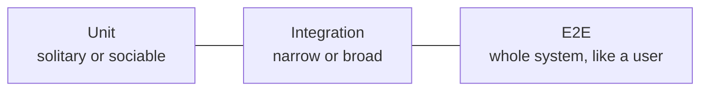

## Problem

Code review. Someone opens a pull request and adds a test file called `checkout.integration.test.ts`. Reviewer comments:

> "This is not an integration test, this is a unit test."

Author answers:

> "It touches three modules, so it's integration."

Forty comments later nobody remembers what the PR was about. Sounds remotely familiar?

I've seen such discussion in the team I worked with. So who is right? Nobody, until the team decides what the words mean. Two well-known and respected people would even give you two different answers, as you'll see in a moment. And if your team never decided, you have a problem that no testing library will fix.

In this article I'll show the two popular conventions for "unit" vs "integration", pick one for the rest of the series, and separate a few things that people constantly mix up under the word "type of test".

## Four axes people mix up

Most naming arguments happen because "type of test" actually means four different things:

- **Scope**: how much of the system runs in the test (unit, integration, e2e).
- **Purpose**: why the test exists (smoke, regression, performance, contract). Will cover that more in next article.
- **Knowledge**: how the test was designed, from the requirements or with the code in front of you (black box, white box).
- **Assertion style**: what the test checks, the result or the way the result was produced (state/behavior vs interaction).

A single test sits on all four at once. "Regression e2e black box test that asserts on behavior" is a perfectly normal sentence. Most of the confusion starts when people put words from different axes into one list, as if they were alternatives.

We start with scope, because that's where the friction from the beginning happens. But first, two words that the scope definitions depend on.

## Two words you need first: collaborator and test double

The next section, and the rest of the series, lean on two terms. Let's define them once.

### Collaborator

**A collaborator is anything the code under test talks to to do its job.** Another function, another class, a repository, an HTTP client, a clock. That's Fowler's word, and in his definition of unit tests it decides everything: do you run the real collaborators, or replace them?

```ts
class CheckoutService {
  constructor(
    private payments: PaymentGateway, // collaborator
    private orders: OrderRepository, // collaborator
    private mailer: Mailer, // collaborator
  ) {}

  async checkout(cart: Cart): Promise<Order> {
    await this.payments.charge(cart.totalInCents);
    const order = await this.orders.save(cart);
    await this.mailer.sendReceipt(order);
    return order;
  }
}
```

`CheckoutService` is the unit. It has three collaborators. In production they talk to a payment provider, a database and an SMTP server, so in a fast test you usually don't want the real ones. That's when you use a test double.

### Test double

**A test double is a stand-in for a collaborator, used only in tests.** The name comes from a stunt double in movies, and it was popularized by Gerard Meszaros and Fowler. People say "mock" for all of it, but there are several kinds, and they differ in what they are for:

| Double    | What it does                                                     | Typical use                                             |
| --------- | ---------------------------------------------------------------- | ------------------------------------------------------- |
| **Dummy** | Is passed around, but never actually used.                       | Fills a required parameter.                             |
| **Stub**  | Returns canned answers.                                          | Controls what the unit _receives_: "the payment fails". |
| **Fake**  | A real, working implementation with a shortcut.                  | In-memory repository instead of a database.             |
| **Spy**   | A stub that also records how it was called.                      | Check afterwards: was it called, with what?             |
| **Mock**  | Pre-programmed with expectations, and fails if they are not met. | Verify the unit _did_ something: "receipt was sent".    |

In code:

```ts
// Dummy: required by the constructor, this test never reaches it
const mailer = {} as Mailer;

// Stub: canned answer
const payments: PaymentGateway = {
  charge: async () => {
    throw new Error("card declined");
  },
};

// Fake: working, but in memory
class InMemoryOrderRepository implements OrderRepository {
  private items = new Map<string, Order>();
  async save(cart: Cart) {
    const order = { id: String(this.items.size + 1), ...cart };
    this.items.set(order.id, order);
    return order;
  }
  async findById(id: string) {
    return this.items.get(id);
  }
}

// Spy: records the calls, we assert on them later
const sendReceipt = vi.fn();
const mailer = { sendReceipt } as Mailer;
// ...run the code...
expect(sendReceipt).toHaveBeenCalledOnce();
```

A mock in the strict sense (Fowler's "Mocks Aren't Stubs") sets the expectation _first_ ("you will be called once with this order") and verifies it itself. In JavaScript, `vi.fn()` or `jest.fn()` gives you a function that behaves as a stub or as a spy, depending on how you use it. `vi.mock('./mailer')` replaces a whole module. Everybody calls the result "a mock", and I'll do the same when I mean the tool, but when it matters I'll say stub, fake or spy.

Why does the difference matter? It maps to the assertion style axis from above:

- **Stubs and fakes** let you assert on the **result**: the returned value, the saved record.
- **Spies and mocks** push you toward asserting on **interaction**: who was called, how many times, with what.

So "a unit test with doubles" can be a perfectly fine state-based test (a stub plus an assertion on the output), or a test welded to the implementation (a mock plus `toHaveBeenCalledWith`). More about this in the assertion style section.

## Two conventions, one test

Let's use a simple domain: an online shop with a checkout. Here is a test of a checkout form in React. It renders the form with its child components and hooks, and fakes only the network:

```tsx
it("shows an error when payment fails", async () => {
  server.use(
    http.post("/api/pay", () => HttpResponse.json({}, { status: 500 })),
  );
  const user = userEvent.setup();

  render(<CheckoutForm />);
  await user.click(screen.getByRole("button", { name: /pay/i }));

  expect(await screen.findByRole("alert")).toBeVisible();
});
```

What is it? It depends on whom you ask.

**Kent C. Dodds** (the author of Testing Library, behind the "testing trophy") would call it an **integration test**. For him, a unit test checks a piece in isolation with its dependencies mocked, and integration tests check several units working together, mocking as little as possible (usually only the network). His trophy puts most of the weight on this layer.

**Martin Fowler** would call it a **sociable unit test**. For him, a unit test is a small, fast test written by programmers, and the dividing line is about collaborators: in a _solitary_ test they are replaced with test doubles, in a _sociable_ test the real ones are used. Integration for Fowler is about communicating with something _outside_ of your code: a _narrow_ integration test exercises the code at that boundary (for example your repository with a real database, or your HTTP client against a double of the remote service), and a _broad_ one runs against live versions of the real services.

Same test, two names, and both are written by people who know what they are doing. And now look at the PR from the beginning. By Fowler's vocabulary the reviewer is probably right: the test targets the behavior of the form, the real collaborators run in memory, and the network is only a double at the edge, so it is a sociable unit test. (Fowler's categories depend on what the test is aimed at. If the test were aimed at the code that talks to `/api/pay`, it would be a narrow integration test.) By Dodds' vocabulary the author is right. That's the whole fight.

**For the rest of this series I'll use Fowler's vocabulary.** Not because it's the correct one. I just need to stick to _something_ when I explain the later concepts, otherwise every paragraph would need a footnote. Please don't stick to it blindly: in your team agree on your own words, write them down in the README (two lines are enough), and treat my labels in this series as a working convention.

## Scope: the usual suspects




Read it as a scale of "how much runs", not as a flow. The more runs, the more the test costs. Only e2e covers the whole path the user takes, from the page down to the database.

### Unit test

**Unit test is a small, fast test of a piece of logic.** Usually one function or one class. It runs in milliseconds, needs no network, no database, no browser. It is _solitary_ when the collaborators are replaced with doubles and _sociable_ when they are real (like the React example above).

```ts
// pricing.ts
const MAX_DISCOUNT_PERCENT = 50;

export function applyDiscount(
  amountInCents: number,
  discountPercent: number,
): number {
  const percent = Math.min(discountPercent, MAX_DISCOUNT_PERCENT);
  return Math.round((amountInCents * (100 - percent)) / 100);
}

export function calculateTotal(
  pricesInCents: number[],
  discountPercent: number,
): number {
  const sum = pricesInCents.reduce((acc, price) => acc + price, 0);
  return applyDiscount(sum, discountPercent);
}

// pricing.test.ts
it("applies 10% discount to the sum of prices", () => {
  expect(calculateTotal([5000, 5000], 10)).toBe(9000);
});

it("returns 0 for an empty cart", () => {
  expect(calculateTotal([], 10)).toBe(0);
});
```

(Money in integer cents, not floats. Different article, but please don't copy `0.1 + 0.2` into your shop.)

This one is sociable too, by the way: `calculateTotal` runs the real `applyDiscount`.

**Cost:** nearly none. Fast, and when it fails you know exactly where. The price: it tells you nothing about whether the parts are wired together correctly. A sociable React test like the one above is a bit heavier: tens to hundreds of milliseconds, and it runs in jsdom, which is not a real browser. No real layout, no real CSS, no real focus behavior. A button hidden behind another element is still "clickable" for jsdom.

### Integration test

**Integration test checks the communication with something outside your code.** The important part: your code that talks to that _something_ has to run for real, otherwise you didn't test the integration. The other side is either real (your repository plus a real database) or a double of the remote service (your HTTP client against a fake of the provider). Both are narrow integration tests. A broad one uses live services on the other side.

```ts
it("saves an order and reads it back", async () => {
  const db = await startTestDatabase(); // e.g. Testcontainers
  const orders = createOrderRepository(db);

  const id = await orders.create({ items: [{ sku: "A1", qty: 2 }] });

  expect(await orders.findById(id)).toMatchObject({
    items: [{ sku: "A1", qty: 2 }],
  });
});
```

**Cost:** slower and heavier. A containerized database means Docker on every developer machine and in CI, seconds of startup, and you need to clean the state between tests, or one test will poison the next. In-memory replacements (SQLite, pg-mem) are faster, but they are not your production database, so you trade confidence for speed. Broad integration tests, with several live services, cost even more.

### E2E test

**End-to-end test drives the whole system the way a user does.** Real browser, real frontend, real backend, real database. For third parties you can't control (like a payment provider) you use their sandbox or test mode, and that is a decision you should make consciously.

```ts
test("customer can buy a product", async ({ page }) => {
  await seedProduct({ slug: "mug", priceInCents: 1500 }); // known data, every run
  await page.goto("/products/mug");
  await page.getByRole("button", { name: "Add to cart" }).click();
  await page.getByRole("link", { name: "Checkout" }).click();
  await payWithTestCard(page); // provider's sandbox card, not a real payment
  await page.getByRole("button", { name: "Pay" }).click();

  await expect(page.getByRole("heading", { name: "Thank you" })).toBeVisible();
});
```

**Cost:** the highest. The slowest suite, the most setup (seeded data, resettable environment, sandboxes), and the most likely to be flaky. When it fails, it tells you that a user journey is broken, not where.

## What they are not

Here is where the arguments from the beginning come from. In this series' vocabulary:

| Test type       | What it is **not**                                                                                                                                                                                                                                                    |
| --------------- | --------------------------------------------------------------------------------------------------------------------------------------------------------------------------------------------------------------------------------------------------------------------- |
| **Unit**        | Not "a test for every function". Not "everything with mocks": a test that mocks 6 dependencies to call one method is testing the mocks. Not a snapshot of rendered HTML, and not a check of how a component is _built_ (which hook was called, what is in the state). |
| **Integration** | Not "a test that touches many files". Three modules in memory is a sociable unit test. It is about a real boundary: database, queue, HTTP, file system.                                                                                                               |
| **E2E**         | Not "the same test, but slower". Not a replacement for all the other tests. And not a script that clicks everything in your app once.                                                                                                                                 |

And the most common mix-ups:

- **"Integration" for everything that is not a pure function.** Then the word loses any meaning.
- **"E2E" for a test that mocks the backend.** If the API is faked, it is a frontend test running in a browser. Useful, but not end-to-end.
- **"Unit" for a test with a real database.** It's integration, even if it is fast and tests one function.

## White box vs black box

Now the third axis: _how the test was designed_.

- **Black box**: the test is designed from the outside, from the requirements. It knows the inputs and the expected outputs, and doesn't care how the result is produced.
- **White box**: the test is designed with the code in front of you, for example to hit a specific branch or a tricky path.


Let's take one function and test it two ways.

**The spec:** "Shipping is free for orders of 100 PLN or more. Otherwise it costs 15 PLN. Premium users always get free shipping."

```ts
function shippingCost(total: number, isPremium: boolean): number {
  if (isPremium) return 0;
  if (total >= 100) return 0;
  if (total === 0) return 0; // not in the spec: an empty cart ships free
  return 15;
}
```

### Black box: you only know the spec

You test inputs against expected outputs and don't look at the code. You pick cases from the requirements: normal values, boundaries, invalid input.

```ts
expect(shippingCost(50, false)).toBe(15); // regular order
expect(shippingCost(100, false)).toBe(0); // boundary: exactly 100
expect(shippingCost(99.99, false)).toBe(15); // just below the boundary
expect(shippingCost(20, true)).toBe(0); // premium user
expect(() => shippingCost(-5, false)).toThrow(); // invalid input: what does the spec say?
```

The last case shows the strength of black box testing. It asks what _should_ happen, and that exposes a gap: the code doesn't validate negative totals (and the spec doesn't say what to do either).

### White box: you read the code

You design tests so that every branch, condition and path runs. The goal is covering the actual implementation.

```ts
// Branch 1: isPremium === true → early return
expect(shippingCost(0, true)).toBe(0);
// Branch 2: not premium, total >= 100
expect(shippingCost(150, false)).toBe(0);
// Branch 3: not premium, total === 0 → the branch the spec never mentions
expect(shippingCost(0, false)).toBe(0);
// Branch 4: not premium, 0 < total < 100 → fallthrough
expect(shippingCost(10, false)).toBe(15);
```

You can see exactly four paths, so four tests give you 100% branch coverage. Run the black box set from the previous section against the same code and branch 3 stays red in the coverage report: nobody could guess it from the spec. Reading the code also raises a question for the spec: should an empty cart really ship free?

### The difference

Black box is based on requirements, white box on code structure. Each one misses what the other catches. White box can't find the missing negative-input check, because there is no branch for it. Black box doesn't guarantee that every branch was executed, like the empty-cart case above that nobody wrote in the spec.

Notice that both sets assert only on the output. So white box is not the problem. The risk sits on the fourth axis.

## Assertion style: result or the way to the result

Whatever the scope or the way you designed the test, you decide what to assert on: **the result** (a returned value, a visible change, a saved record), or **the way the result was produced** (which function was called, with what, how many times).

Here is the second kind. To even write it, we had to change production code, because without that the spy can't intercept the internal call:

```ts
// pricing.ts: a parameter added only so the test can replace the function
export function calculateTotal(
  pricesInCents: number[],
  discountPercent: number,
  discount = applyDiscount,
): number {
  const sum = pricesInCents.reduce((acc, price) => acc + price, 0);
  return discount(sum, discountPercent);
}

// Interaction test: asserts on HOW the work is done
it("calls applyDiscount with the sum", () => {
  const discount = vi.fn(() => 0);
  calculateTotal([5000, 5000], 10, discount);
  expect(discount).toHaveBeenCalledWith(10000, 10);
});
```

Now inline `applyDiscount` into `calculateTotal` and remove the parameter. The result for the user is exactly the same. The `calculateTotal` tests from the unit test section are still green. This one doesn't even compile, and the afternoon goes to fixing a test that found no bug.

That's what I mean by implementation details, and it's independent of the other axes: you can write it as a unit test, as an integration test, white box or black box. The two axes are easy to confuse, but they are different questions: _how did I come up with this test?_ and _what does it assert on?_

This doesn't mean interaction tests are wrong. They need to be written with great care. I often see them overused in places where they don't fit, and then they fail on every refactor, because the implementation changes often and these tests check the implementation, not the requirement.

Sometimes the interaction _is_ the requirement. Look at `CheckoutService.checkout` from the beginning: it returns only the order, and "a receipt was sent" is a side effect with no return value. Asserting that `mailer.sendReceipt` was called with this order checks a requirement, not an implementation detail. The same goes for "always go through this specific service", for example an audit log or a payment gateway. A question that helps: if I rewrote the internals, would the requirement still demand this call? If yes, the interaction assertion is fine. If no, assert on the result.

Both styles are tools with a cost. Result assertions survive refactors but can't see side effects that return nothing. Interaction assertions can see them, but they are welded to how the code is written. I'll come back to this in next articles, because I have strong opinions about where the line should be.

## What's next

Scope, knowledge and assertion style are done. In part 2 we go through the purpose axis: smoke, performance, contract, regression, and why flaky is a property of a test and not a type of test.

## Summary

Unit, integration and e2e are not laws of nature. They are names for "how much of the system runs in this test", and even Fowler and Dodds draw the border in different places (a React test with real children and a faked network is a sociable unit test for one, an integration test for the other). Agree on the definitions inside your team, and separate four axes in your head: scope, purpose, knowledge and assertion style.

To write better tests, first understand why you write a test: to catch regressions, to document a requirement, to be able to refactor safely, to protect a critical user journey. Then decide which type of test helps you the most with that goal, on each of the four axes. And ask yourself if you need code coverage for anything other than bragging about 80%+. A coverage report is useful as a map of what no test ever ran, like the empty-cart branch above. A high number alone says nothing about whether the tests check anything that matters.

That's all. I hope you enjoyed this article. Thanks for reading!

**Here's an addon for you.** A brief summary of the article. You can use it to create flashcards (e.g. in Anki).

### What is a unit test (Fowler)?

A small, fast test of a piece of logic, usually one function or class, written by programmers.

### What is a collaborator?

Anything the code under test talks to in order to do its job: another function, class, repository, HTTP client, clock.

### What is a test double?

A stand-in for a collaborator, used only in tests. Kinds: dummy, stub, fake, spy, mock.

### What is the difference between a stub and a mock?

A stub returns canned answers (controls what the unit receives). A mock has expectations about calls and fails if they are not met (verifies what the unit did).

### What is a fake?

A real working implementation with a shortcut, e.g. an in-memory repository instead of a database.

### What is a spy?

A stub that also records how it was called, so you can assert on the calls afterwards.

### What is a dummy?

An object passed only to fill a required parameter. It is never used.

### What is a solitary unit test?

A unit test where the collaborators are replaced with test doubles.

### What is a sociable unit test?

A unit test where the collaborators are real.

### What would Kent C. Dodds call a React test with real child components and a faked network?

An integration test. Fowler would call the same test a sociable unit test.

### What is the main limit of component tests in jsdom?

jsdom is not a real browser: no real layout, CSS or focus behavior.

### What is an integration test (Fowler)?

A test of the communication with something outside your code. That something has to be real in the test.

### What is a narrow integration test?

A test of the code at the boundary, e.g. your repository against a real database.

### What is a broad integration test?

A test that runs against live versions of all the involved services.

### What is the cost of integration tests with a real database?

Docker on dev machines and CI, startup time, and state cleanup between tests.

### What is an e2e test?

A test that drives the whole system the way a user does, in a real browser against a real backend.

### How do you handle a payment provider in e2e tests?

Use the provider's sandbox or test mode instead of real payments.

### Is a test with a mocked backend running in a browser an e2e test?

No. If the API is faked, it is a frontend test running in a browser.

### Who decides what "unit" and "integration" mean in your project?

Your team. There is no universal definition, so write yours down.

### What are the four axes of a test's "type"?

Scope (unit to e2e), purpose (smoke, regression, performance, contract), knowledge (black vs white box), assertion style (result vs interaction).

### What is a black box test?

A test designed from the requirements: it knows inputs and expected outputs, not how the result is produced.

### What is a white box test?

A test designed with the code in view, e.g. to run every branch. It can still assert only on outputs.

### What is an interaction test?

A test that asserts on how the result was produced (which function was called, with what arguments) instead of on the result.

### What is the real danger of asserting on implementation details?

The test breaks on refactors that don't change behavior, and finds no bugs.
